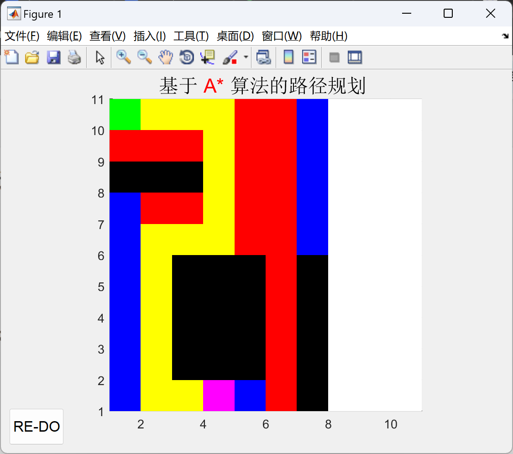
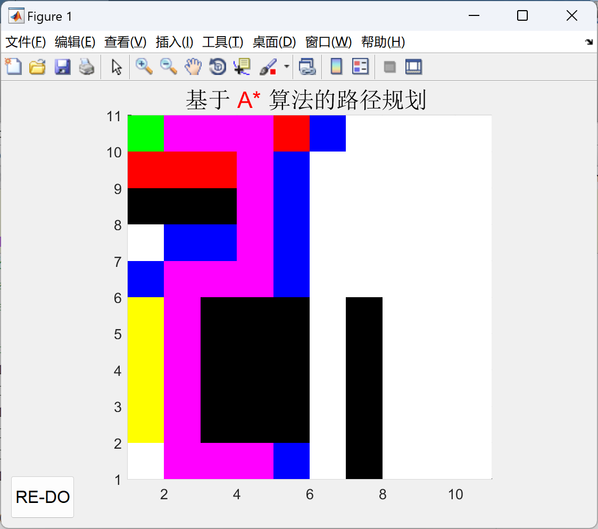
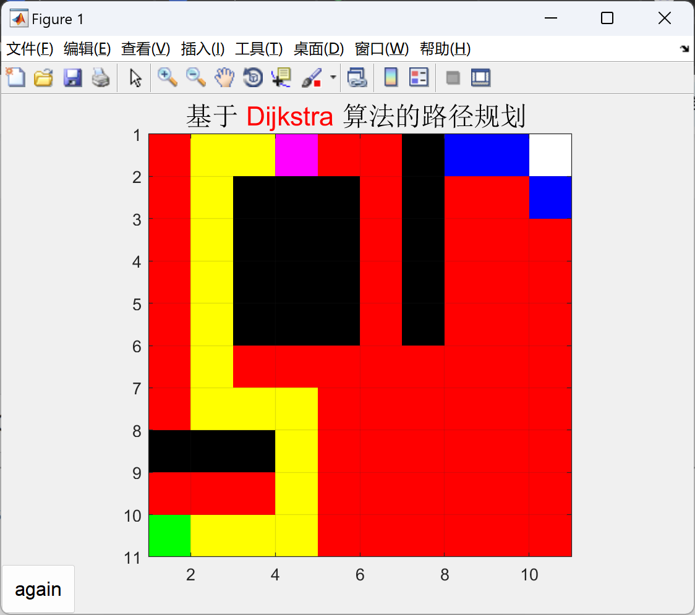

# Research on Path Planning Based on A* Algorithm and Dijkstra Algorithm (Matlab Code Implementation)

1. Introduction
Path planning is an important research direction in the field of artificial intelligence, especially widely applied in robot navigation, autonomous driving, and map navigation. A* algorithm and Dijkstra algorithm are two classic path planning algorithms with their unique advantages and application scopes. This paper will conduct a deep study on these two algorithms, exploring their principles, characteristics, implementation methods, and applications in path planning.
2. Algorithm Principles
1. Overview of Dijkstra's Algorithm:
Dijkstra's algorithm is used to find the shortest path from a single starting point to all other points in a graph. It mainly relies on greedy strategy, gradually expanding the set of nodes known to have the shortest distance until all nodes have their shortest paths.
Implementation steps:
- Initialize: Set the distance of the starting point s to 0, and the distance of all other nodes to infinity.
- Select node: Choose the node u with the smallest distance from the unprocessed nodes.
- Update distance: For each neighbor node v of u, if the distance from u to v is shorter than the known distance, update the distance of v.
- Mark node u as processed and remove it from the unprocessed node set.
- Repeat steps 2-4 until all nodes are processed.
- Characteristics:
- Can find the global shortest path.
- Suitable for unweighted graphs or weighted graphs where all edge weights are positive.
- High computational complexity, especially for large graphs.
2. Overview of A* Algorithm:
A* algorithm is a heuristic search algorithm that combines the global optimality of Dijkstra's algorithm and the efficiency of greedy algorithms. It introduces a heuristic function to evaluate the estimated cost from a node to the target point, thus selecting the most promising node for expansion.
Implementation steps:
- Initialize: Create two lists, OPEN list for storing nodes to be considered, CLOSED list for storing nodes that have been considered.
Add the starting point to the OPEN list and calculate its F-value (G-value + H-value, where G-value is the actual cost from the starting point to the current node, and H-value is the estimated cost from the current node to the target point based on a heuristic function).
Select the node u with the smallest F-value from the OPEN list.
If u is the target node, then path planning is successful, backtracking the path.
Otherwise, add u to the CLOSED list and examine all of u's neighbors v.
If v is not in the CLOSED list, calculate the G-value, H-value, and F-value of v, and update the OPEN list if v is already in the OPEN list and the new F-value is smaller.
Repeat steps 3-6 until the target node is found or the OPEN list is empty.
Characteristics:
Search efficiency, capable of quickly finding the shortest path.
Design of heuristic functions has a significant impact on algorithm performance.
Applicable to complex environments with obstacles.
Algorithm comparison:
Dijkstra's algorithm vs. A* algorithm
Principle:
Based on greedy strategy, gradually expand known shortest paths combined with greedy algorithm and heuristic search, using heuristic functions to evaluate nodes applicable to unweighted graphs or weighted graphs with all edges having positive weights and complex environments with obstacles characteristics Global optimality, but high computational complexity Search efficiency, influence of heuristic function design advantage Finds global shortest path quickly, adapts to complex environments disadvantage High computational demand, not suitable for large graphs Heuristic function design complex, may affect results
Conclusion and Outlook
The A* algorithm and the Dijkstra algorithm are classic algorithms in path planning, each with its unique advantages and applicability. In practical applications, it is necessary to choose the appropriate algorithm based on specific scenarios and requirements. In the future, as artificial intelligence technology continues to develop, path planning algorithms will be continuously optimized and innovated to better adapt to complex and changing environments.
The above is a summary of the research document on path planning using the A* algorithm and the Dijkstra algorithm. For more detailed information, further expansion and in-depth discussion can be conducted as needed.
2.1 A* Algorithm
2.2 Dijkstra Algorithm
Partial code:
cmap = [1 1 1; ... % 1 - white - empty space
0 0 0; ... % 2 - black - obstacle
1 0 0; ... % 3 - red - visited places
0 0 1; ... % 4 - blue - next search center
0 1 0; ... % 5 - green - starting point
1 1 0;... % 6 - yellow - path to target point
1 0 1];% 7 - target point
colormap(cmap);
map1 = zeros(10);
wallpercent=0.4;
% Set obstacles
map1(1:5, 7) = 2;
map1(8,1:3) = 2;
map1(2:5,3:5)=2;
%map1(ceil(10^2.*rand(floor(10*10*wallpercent),1))) =2;
% map(ceil(10.*rand),ceil(10.*rand)) = 5; % Starting point
%map(ceil(10.*rand),ceil(10.*rand)) = 6; % Target points
%%% Create map
nrows = 10;

## Images

<!-- PAYMENT_BLOCK -->

## Get this dataset

- Payment link (Stripe): [Buy now](https://buy.stripe.com/3cs8yP7sY87d0vu9AB)
- Payment QR code: 

<!-- /PAYMENT_BLOCK -->
